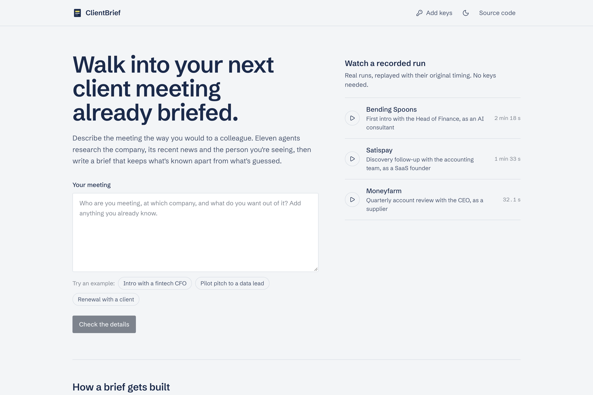
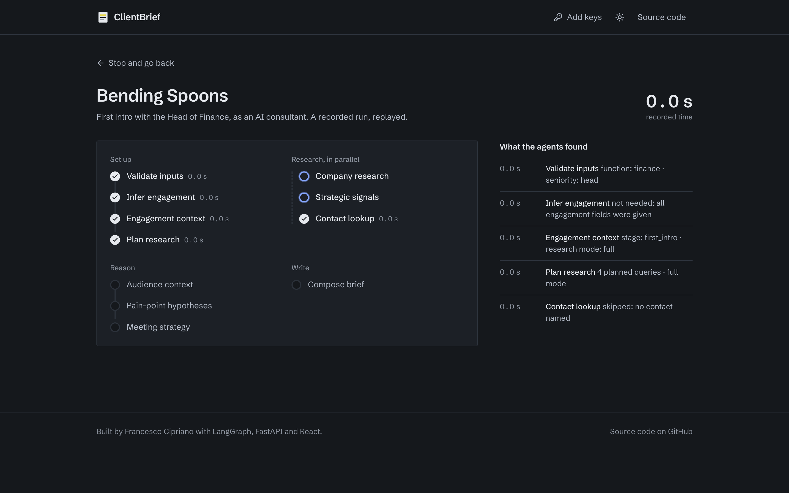
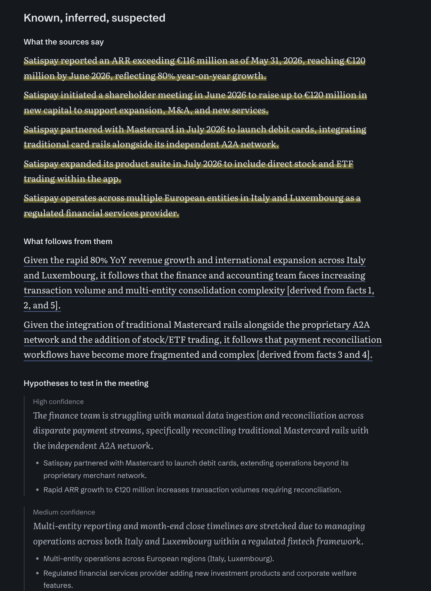
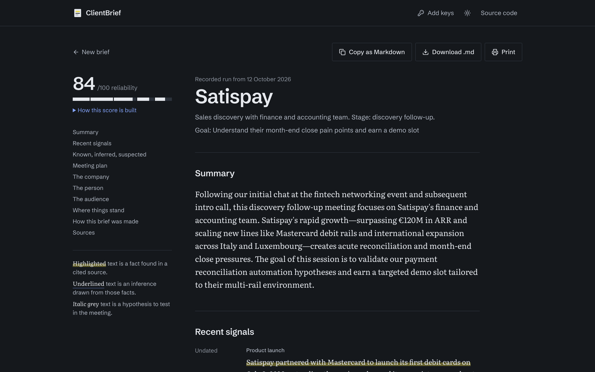
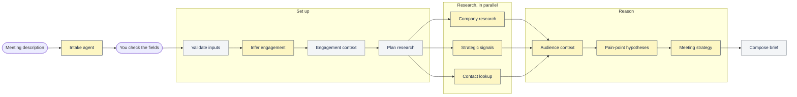

# ClientBrief AI

Describe an upcoming client meeting the way you would to a colleague. Eleven agents research
the company, its recent news and the person you're meeting, then write a brief that keeps
what is known apart from what is guessed.



You can try it without any API key: the home page replays three real runs (Bending Spoons,
Satispay, Moneyfarm) with their original timing. With your own keys you can run it live on any
company.

## What you get

The pipeline runs as a LangGraph graph and streams its progress to the browser. The three
research agents work in parallel, and each step shows which model answered and how long it
took. When the free tier of the preferred model is busy, the step falls back to a faster model,
and the UI says so.



The brief separates three kinds of statement, because mixing them is what makes AI research
dangerous to bring into a meeting. Facts come from a cited source and are highlighted.
Inferences follow from those facts and are underlined. Hypotheses are things to test in the
conversation, set in grey italics with the evidence behind them.



Every brief also gets a reliability score out of 100, built from named parts you can inspect:
source coverage, independent sites, strategic signals, how recent they are, whether the contact
was matched, and how cleanly the run went. A thin brief says so instead of sounding confident.



## How it works



Grey steps are plain rules; yellow steps call a language model, and the three research steps
search the web with Tavily first. Some choices worth knowing about:

- **Language models only where judgement is needed.** Validation, research planning,
  engagement-stage logic and the final layout are deterministic code. Each agent owns one slice
  of the shared state, and the parallel research nodes merge through LangGraph reducers.
- **Two model tiers.** Extraction runs on a fast model (`gemini-3.5-flash-lite` by default) and
  the three reasoning agents on a stronger one (`gemini-3.6-flash`). Calls retry on 429/503 and
  timeouts, then fall back to the other tier, so a busy free tier slows a brief down instead of
  breaking it. Invalid JSON gets one repair attempt.
- **Any provider.** Gemini is the default, and any OpenAI-compatible API (Groq, DeepSeek,
  OpenRouter, a local Ollama) works by changing environment variables.
- **Streaming.** LangGraph's `tasks` and `updates` streams become Server-Sent Events. Live runs
  and recorded demos use the same event format, so they render through the same UI code.
- **Safe "bring your own key".** Keys typed into the site stay in the browser and travel only
  with the visitor's own requests; the server never stores or logs them. Visitors pick a
  provider from an allowlist and can't point the server at an arbitrary URL.
- **A capped public server.** `PUBLIC_DAILY_RUNS` limits live runs on the server's own keys,
  so a public deploy can show recorded runs to everyone without spending money.

## Run it locally

You need Python 3.11+, Node 22, a [Gemini API key](https://aistudio.google.com/app/apikey)
and a [Tavily key](https://app.tavily.com). Both have free tiers.

```bash
git clone https://github.com/thunderszz/clientbrief-ai.git
cd clientbrief-ai
python -m venv .venv && source .venv/bin/activate
pip install -r requirements-dev.txt
cp .env.example .env   # then add GEMINI_API_KEY and TAVILY_API_KEY
```

Build the web app once, then start the server; it serves both the API and the UI on
<http://localhost:8000>:

```bash
cd web && npm ci && npm run build && cd ..
uvicorn api.main:app --reload
```

For frontend work, run `npm run dev` in `web/` instead: Vite serves the UI on port 5173 and
proxies `/api` to the Python server. There is also a terminal version: `python -m app.main`.

With Docker:

```bash
docker build -t clientbrief-ai .
docker run -p 8000:8000 --env-file .env clientbrief-ai
```

### Configuration

| Variable | Default | What it does |
|---|---|---|
| `LLM_PROVIDER` | `gemini` | `gemini` or `openai_compatible` |
| `GEMINI_API_KEY` | | Needed for the Gemini provider |
| `LLM_API_KEY`, `LLM_BASE_URL` | | Needed for `openai_compatible` |
| `LLM_MODEL_FAST` | `gemini-3.5-flash-lite` | Model for extraction steps |
| `LLM_MODEL_REASONING` | `gemini-3.6-flash` | Model for audience, pain points and strategy |
| `TAVILY_API_KEY` | | Web search for the research agents |
| `PUBLIC_DAILY_RUNS` | unlimited | Live runs per day on the server's keys; `0` on a public deploy |

To record a new demo from a real run: `python -m scripts.record_demo --slug acme --title "Acme" --text "…"`.

## Tests

```bash
pytest                    # offline: no network, no keys
cd web && npm test        # parser, run state, storage and formatting
```

The Python suite covers the LLM client's retry, fallback and repair logic, the reliability
score, the API (keys, quota, SSE stream, failures mid-run, demo replay), node summaries, and a
full run of the real graph with every external call failing. GitHub Actions runs both suites,
type-checks and builds the web app, and builds and smoke-tests the Docker image.

## Project layout

```
agents/      one module per pipeline step, plus the intake agent
core/        graph wiring, shared state, pipeline metadata, reliability score, result shape
services/    LLM client (providers, tiers, retries), Tavily client, provider presets
api/         FastAPI app: intake, SSE run stream, demo replay, daily quota
web/         React + Vite + TypeScript UI
demo/        recorded runs, replayed by the public site
scripts/     demo recorder
tests/       pytest suite
docs/        design spec, original project spec, screenshots
```

## What I'd do next

- An evaluation set: a few dozen meetings with hand-checked briefs, to compare models and
  prompts on facts that turned out to be wrong rather than on impressions.
- Wire the file cache into the graph. Today the orchestrator can read cached research, but
  nothing writes it.
- Save briefs per user, and let a second meeting with the same company start from the first
  brief.
